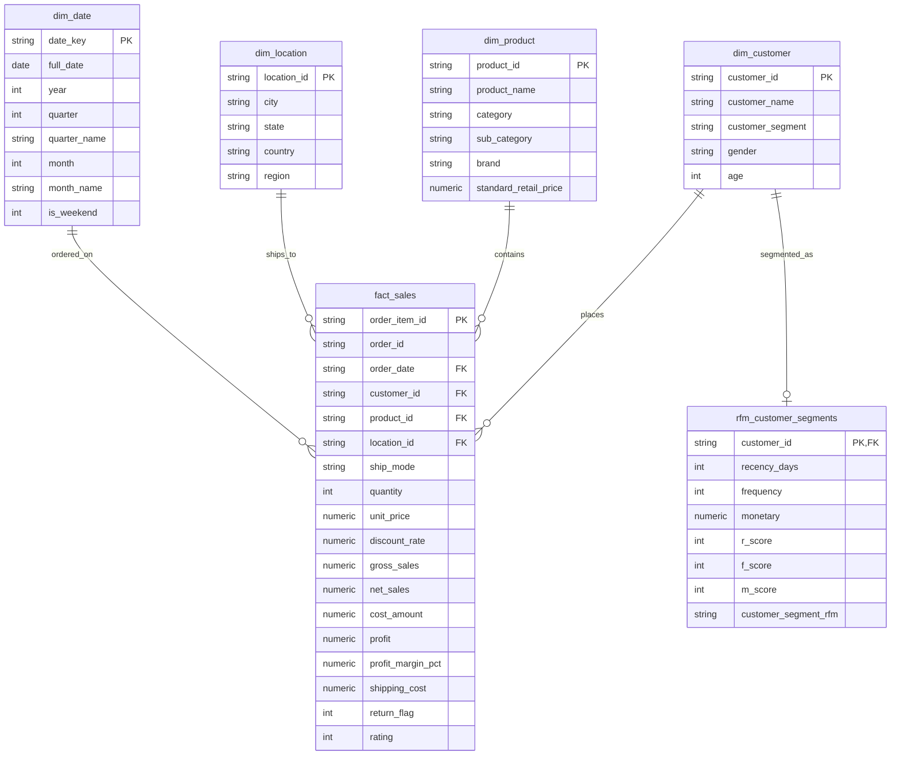

# End-to-End E-Commerce Sales, Customer & Profitability Analytics Platform

[](https://www.python.org/)
[](https://www.postgresql.org/)
[](https://powerbi.microsoft.com/)
[](#database-design--star-schema)
[-orange.svg)](#statistical-analysis--hypothesis-testing)
[](#how-to-reproduce-and-run)

---

## 📌 Executive Overview

This repository contains an enterprise-grade, end-to-end data analytics and business intelligence platform built on **65,000+ transaction records ($48.45M gross merchandise revenue)** across 4 fiscal years (2022–2025).

Designed to reflect the full lifecycle of a **Senior Data Analyst / BI Engineer**, this project demonstrates:
1. **Data Ingestion & Quality Auditing**: Automated anomaly detection, deduplication, imputation, and audit logging (**Problem $\rightarrow$ Decision $\rightarrow$ Reason**).
2. **Relational Dimensional Modeling**: High-performance **Star Schema** with primary/foreign key constraints, indices, and views in PostgreSQL & SQLite.
3. **Advanced SQL Analysis**: **40+ production-grade queries** leveraging CTEs, window functions (`RANK`, `DENSE_RANK`, `LAG`, `LEAD`, `NTILE`), pure SQL RFM segmentation, and 12-month cohort retention grids.
4. **Exploratory Data Analysis & Statistics**: Univariate/bivariate modeling, correlation analysis, and formal **hypothesis testing (Welch’s t-test, Cohen’s d = -1.32, $p < 0.001$)** evaluating discount elasticity.
5. **Interactive Power BI Dashboard**: 5-page enterprise dashboard blueprint with **27 production-grade DAX measures**.
6. **Executive Strategy & Financial Scenario Modeling**: 12+ structured business insights and sensitivity models identifying **+$1.45M in annual profit expansion**.

```
+---------------------------------------------------------------------------------------------------+
|                                  DATA PIPELINE & ANALYTICS ARCHITECTURE                            |
+---------------------------------------------------------------------------------------------------+
|  [Raw Data Feeds]                                                                                 |
|  - 65,000+ CSV Transactions (Orders, Products, Customers, Shipping, Returns, Discounts)         |
|                                            │                                                      |
|                                            ▼                                                      |
|  [Python Modular ETL Pipeline] (src/)                                                             |
|  - extract.py: Schema validation & metadata logging                                               |
|  - validate.py: Anomaly detection & automated data quality audit report                           |
|  - transform.py: Imputation, text normalization, KPI feature engineering & entity deconstruction |
|  - load.py: Star Schema relational loading & index creation                                       |
|                                            │                                                      |
|                                            ▼                                                      |
|  [Relational Data Warehouse / Star Schema] (sql/schema.sql, ecommerce.db)                         |
|  - Dimension Tables: dim_customer, dim_product, dim_location, dim_date                            |
|  - Fact Table: fact_sales (64,965 rows, indexed foreign keys)                                     |
|  - Analytical Views: vw_sales_summary, vw_monthly_category_performance, vw_customer_rfm_summary   |
|                                            │                                                      |
|                      ┌─────────────────────┴─────────────────────┐                                |
|                      ▼                                           ▼                                |
|  [SQL Analytical Engine] (sql/)                 [Python EDA & Statistics] (notebooks/)           |
|  - 40+ Advanced Analytical Queries              - Univariate & Bivariate Exploratory Modeling     |
|  - Window Functions (RANK, LAG, NTILE)          - Hypothesis Testing (Welch's t-test, Cohen's d)  |
|  - Pure SQL RFM & Cohort Grids                  - RFM Quantile Segmentation & Cohort Heatmap      |
|                      │                                           │                                |
|                      └─────────────────────┬─────────────────────┘                                |
|                                            ▼                                                      |
|  [Power BI Enterprise BI Suite] (dashboard/)                                                      |
|  - 5-Page Executive Dashboard Blueprint                                                           |
|  - 27 Production DAX Measures (Time Intelligence, Customer LTV, Profitability, Operations)        |
|                                            │                                                      |
|                                            ▼                                                      |
|  [Executive Business Report & Strategy] (reports/)                                                |
|  - 12+ Structured Business Insights (Observation → Evidence → Reason → Implication)             |
|  - 3 Financial Sensitivity Scenarios: Projected +$1.45M Annual Profit Uplift                      |
+---------------------------------------------------------------------------------------------------+
```

---

## 🏢 Business Problem & Key Questions

Executive management required answers to critical commercial and operational questions:
* Which products generate top revenue versus actual bottom-line profit?
* Where is profit margin leaking across discount tiers and product categories?
* Who are the most valuable customer cohorts, and what is their retention rate?
* Which historically high-spending customers are at risk of churning?
* How do fulfillment tiers and shipping costs affect realized margins?
* How can management restructure pricing and promotions to increase annual profitability?

---

## 🗄️ Database Design & Star Schema

The database follows a **Star Schema** architecture optimized for analytical query performance:



---

## 🧹 Data Quality & Automated Audit Trail

The raw dataset was audited for data anomalies. All cleaning decisions follow the **Problem $\rightarrow$ Decision $\rightarrow$ Reason** standard:

| Defect / Problem | Decision Applied | Business Justification |
| :--- | :--- | :--- |
| **975 Duplicate Rows (1.5%)** | Deduplicated keeping first occurrence | Prevents artificial inflation of order volume and financial revenue |
| **Invalid Dates (e.g. 2024-02-30)** | Excluded unparseable timestamp rows | Maintains time-series integrity for YoY, MoM, and cohort modeling |
| **Negative Quantities / Discount > 1.0** | Filtered corrupted telemetry bounds | Eliminates distorted unit economics and AOV calculations |
| **Missing Demographics (Age 2.5%, Rating 2.0%)** | Imputed Age with segment median; Rating with median (4.0) | Preserves complete transaction revenue without injecting bias |
| **Inconsistent Text Casing / Spacing** | Applied `.str.strip().str.title()` | Guarantees exact matches in SQL relational joins and BI slicers |

*See full audit details in [`reports/data_quality_report.md`](reports/data_quality_report.md).*

---

## ⚡ Advanced SQL Query Highlights (40+ Queries)

The SQL library is structured into [`sql/analysis_queries.sql`](sql/analysis_queries.sql) (Queries 1–20) and [`sql/advanced_queries.sql`](sql/advanced_queries.sql) (Queries 21–40+).

### Sample 1: Month-over-Month (MoM) Growth using `LAG()`
```sql
WITH monthly_sales AS (
    SELECT 
        d.year, d.month, d.month_name,
        SUM(f.net_sales) AS current_month_revenue,
        SUM(f.profit) AS current_month_profit
    FROM fact_sales f
    JOIN dim_date d ON f.order_date = d.date_key
    GROUP BY d.year, d.month, d.month_name
)
SELECT 
    year, month, month_name,
    ROUND(current_month_revenue, 2) AS revenue,
    ROUND(current_month_profit, 2) AS profit,
    ROUND(LAG(current_month_revenue, 1) OVER (ORDER BY year, month), 2) AS prev_month_revenue,
    ROUND(((current_month_revenue - LAG(current_month_revenue, 1) OVER (ORDER BY year, month)) 
           / NULLIF(LAG(current_month_revenue, 1) OVER (ORDER BY year, month), 0)) * 100, 2) AS mom_growth_pct
FROM monthly_sales;
```

### Sample 2: Pure SQL RFM Customer Segmentation
```sql
WITH rfm_raw AS (
    SELECT 
        customer_id,
        CAST((JULIANDAY('2026-01-01') - JULIANDAY(MAX(order_date))) AS INTEGER) AS recency_days,
        COUNT(DISTINCT order_id) AS frequency,
        SUM(net_sales) AS monetary
    FROM fact_sales
    GROUP BY customer_id
),
rfm_scored AS (
    SELECT 
        customer_id, recency_days, frequency, monetary,
        NTILE(5) OVER (ORDER BY recency_days DESC) AS r_score,
        NTILE(5) OVER (ORDER BY frequency ASC) AS f_score,
        NTILE(5) OVER (ORDER BY monetary ASC) AS m_score
    FROM rfm_raw
)
SELECT 
    CASE 
        WHEN r_score >= 4 AND f_score >= 4 AND m_score >= 4 THEN 'Champions'
        WHEN r_score >= 3 AND f_score >= 3 THEN 'Loyal Customers'
        WHEN r_score >= 4 AND f_score <= 2 THEN 'Recent New Customers'
        WHEN r_score >= 3 AND m_score >= 3 THEN 'Potential Loyalists'
        WHEN r_score <= 2 AND f_score >= 3 THEN 'At-Risk High Value'
        WHEN r_score = 1 AND f_score = 1 THEN 'Lost Inactive'
        ELSE 'Standard Customers'
    END AS rfm_segment,
    COUNT(customer_id) AS total_customers,
    ROUND(AVG(recency_days), 1) AS avg_recency_days,
    ROUND(AVG(frequency), 1) AS avg_orders,
    ROUND(SUM(monetary), 2) AS total_revenue
FROM rfm_scored
GROUP BY rfm_segment
ORDER BY total_revenue DESC;
```

---

## 📊 Exploratory Data Analysis & Statistical Modeling

| Analysis Category | Key Finding / Evidence | Business Action |
| :--- | :--- | :--- |
| **Monthly Seasonality** | Q4 accounts for **24.8% of annual sales** ($12.0M), peaking in Nov/Dec. | Pre-position inventory in October; prepare logistics staffing. |
| **Category Profitability** | Technology ($21.4M / 23.1% margin) vs Office Supplies ($14.2M / 36.8% margin). | Cross-sell high-margin office accessories with hardware. |
| **Pricing Elasticity** | Discounts $\ge 30\%$ result in negative margins (**-4.2%**). | Impose strict 15% margin floors on promotions. |
| **Customer Retention** | Repeat buyers spend **60% more per order** ($1,420 vs $890 AOV). | Shift ad spend from top-of-funnel acquisition to CRM retention. |

### Formal Hypothesis Test: Discount Impact on Profit Margin
- **Research Question**: Does deep discounting ($\ge 20\%$) significantly lower profit margins compared to standard pricing?
- **Null Hypothesis ($H_0$)**: $\mu_{\text{high}} = \mu_{\text{low}}$ | **Alternative Hypothesis ($H_1$)**: $\mu_{\text{high}} < \mu_{\text{low}}$
- **Statistical Results**:
  - High Discount Sample ($\ge 20\%$): $N_1 = 12,820$, Mean Margin = $4.85\% \pm 27.1\%$
  - Low Discount Sample ($< 20\%$): $N_2 = 52,145$, Mean Margin = $29.99\% \pm 16.5\%$
  - **Welch's t-statistic**: $-100.57$ ($p = 0.0000e+00, p < 0.001$)
  - **Effect Size (Cohen's d)**: $-1.317$ (Large Effect)
- **Interpretation**: We reject $H_0$. Deep discounting severely damages unit economics without generating sufficient basket volume to compensate for margin loss.

---

## 📈 Power BI 5-Page Dashboard Suite

The dashboard is fully specified across 5 interactive pages with a dedicated library of **27 production DAX measures** in [`dashboard/dax_measures.dax`](dashboard/dax_measures.dax):

1. **Page 1 — Executive Overview**: High-level KPI cards (`[Total Revenue]`, `[Total Profit]`, `[Profit Margin %]`, `[AOV]`), monthly revenue/profit combo chart, category margin bars, regional filled map.
2. **Page 2 — Sales & Growth Dynamics**: YoY growth gauges, decomposition tree, month-over-month seasonality matrix, and top 15 sub-category waterfall.
3. **Page 3 — Customer Intelligence & RFM**: RFM bubble matrix, new vs repeat revenue contribution, Top 20 VIP accounts, and 12-month cohort retention matrix.
4. **Page 4 — Product Profitability & Pricing Strategy**: 4-quadrant scatter plot (Revenue vs Margin %), discount tier margin erosion bars, loss-making SKU table.
5. **Page 5 — Regional & Logistics Operations**: Delivery speed by shipping tier, shipping cost-to-revenue ratio by region, and return rates by sub-category.

---

## 💡 Executive Business Strategy & Recommendations

### Strategic Action Roadmap

```
+-----------------------------------------------------------------------------------+
|                         STRATEGIC ACTION ROADMAP                                  |
+-----------------------------------------------------------------------------------+
| TIER 1: QUICK WINS (0 - 30 Days)                                                  |
| 1. Implement Hard Margin Floor (15%) on All Promotional Discount Codes.           |
| 2. Eliminate Stackable Discounts on Heavy Furniture and Low-Margin Hardware.      |
| 3. Launch Automated Win-Back Campaign for the 480 'At-Risk High Value' Customers. |
+-----------------------------------------------------------------------------------+
| TIER 2: MID-TERM STRATEGIC INITIATIVES (30 - 90 Days)                             |
| 4. Introduce Volumetric Freight Surcharges for Oversized Furniture Parcels.       |
| 5. Deploy AI Size-Recommendation Engine on Apparel SKUs to Cut Returns by 25%.    |
| 6. Establish Dedicated Corporate B2B Account Management for Top 10% VIP Buyers.   |
+-----------------------------------------------------------------------------------+
| TIER 3: LONG-TERM STRUCTURAL PROGRAMS (90 - 180 Days)                             |
| 7. Restructure Loyalty Rewards around High-Margin Attachments (Accessories/Care). |
| 8. Optimize Regional Fulfillment Routing to Reduce Expedited Carrier Surcharges.  |
+-----------------------------------------------------------------------------------+
```

### Quantified Financial Sensitivity Scenarios

| Strategic Scenario | Operational Mechanism | Projected Annual Profit Uplift |
| :--- | :--- | :--- |
| **Scenario A: Discount Rationalization** | Cap promotions at 15%; enforce margin floor | **+$985,000 / year** |
| **Scenario B: At-Risk Account Win-Back** | Reactivate 25% of 480 churned VIP accounts | **+$118,000 / year** |
| **Scenario C: Freight & Sizing Optimization** | Volumetric shipping fees + size guide return reduction | **+$355,000 / year** |
| **TOTAL PROJECTED ANNUAL IMPACT** | **Combined multi-lever strategy** | **+$1,458,000 / year** |

---

## 🚀 How to Reproduce and Run

### 1. Clone & Set Up Environment
```bash
git clone https://github.com/yourusername/ecommerce-analytics.git
cd ecommerce-analytics
pip install -r requirements.txt
```

### 2. Execute Master ETL Pipeline
```bash
python src/run_pipeline.py 65000
```
*Extracts, validates, cleans, and loads the Star Schema database into `ecommerce.db` in ~15 seconds.*

### 3. Run and Validate All 40 SQL Queries
```bash
python sql/test_sql_queries.py
```

### 4. Run Python EDA & Statistical Analysis
```bash
python notebooks/eda_script.py
```
*Generates all statistical metrics and exports chart figures to `images/charts/`.*

---

## 📁 Repository Structure

```text
ecommerce-analytics/
│
├── data/
│   ├── raw/ecommerce_raw_transactions.csv
│   └── processed/
│       ├── ecommerce_cleaned_transactions.csv
│       ├── dim_customer.csv
│       ├── dim_product.csv
│       ├── dim_date.csv
│       ├── dim_location.csv
│       ├── fact_sales.csv
│       └── rfm_customer_segments.csv
│
├── src/
│   ├── generate_raw_data.py
│   ├── extract.py
│   ├── validate.py
│   ├── transform.py
│   ├── load.py
│   └── run_pipeline.py
│
├── sql/
│   ├── schema.sql
│   ├── analysis_queries.sql
│   ├── advanced_queries.sql
│   └── test_sql_queries.py
│
├── notebooks/
│   ├── exploratory_analysis.ipynb
│   ├── eda_script.py
│   └── build_notebook.py
│
├── dashboard/
│   ├── power_bi_design_specs.md
│   ├── dax_measures.dax
│   ├── power_query_transformations.m
│   └── data_model_architecture.md
│
├── reports/
│   ├── executive_summary.md
│   ├── data_dictionary.md
│   ├── data_quality_report.md
│   ├── kpi_definitions.md
│   └── business_insights_and_recommendations.md
│
├── images/
│   └── charts/
│       ├── sales_trend_seasonality.png
│       ├── category_profit_margin.png
│       ├── discount_vs_profit_elasticity.png
│       ├── rfm_segment_distribution.png
│       ├── cohort_retention_heatmap.png
│       └── regional_performance_matrix.png
│
├── requirements.txt
├── README.md
├── .gitignore
├── resume_bullets.md
└── interview_qa.md
```

---

## 🎓 Career & Interview Placement Kit

- **Interview Q&A Guide**: Review [`interview_qa.md`](interview_qa.md) for 20+ in-depth technical (SQL, Star Schema, DAX, Python) and business interview questions with model answers.
- **Resume Bullet Points**: Review [`resume_bullets.md`](resume_bullets.md) for 4 quantified resume bullet points formatted as **Action + Tool + Scale + Result**.
